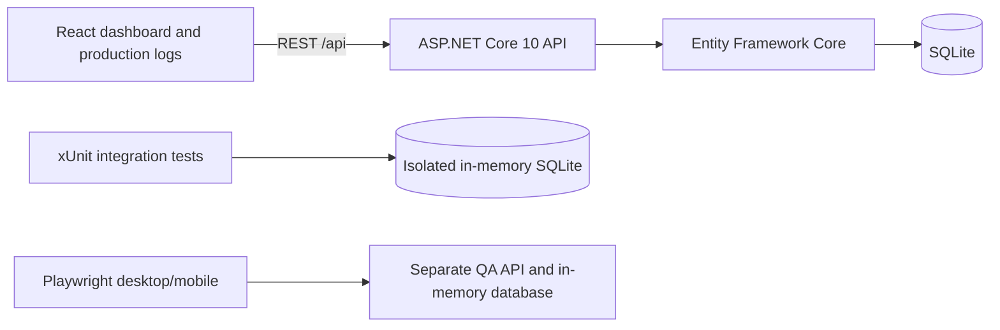
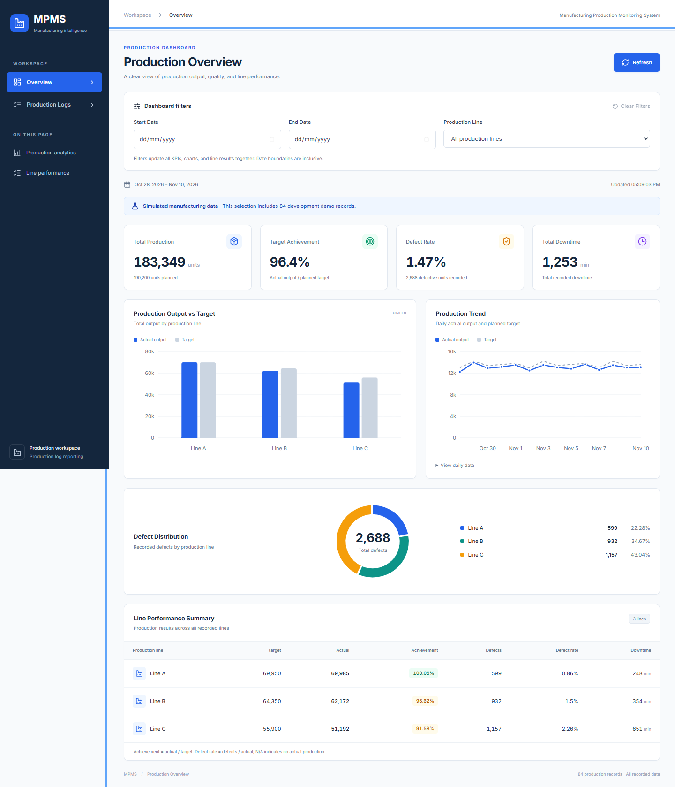
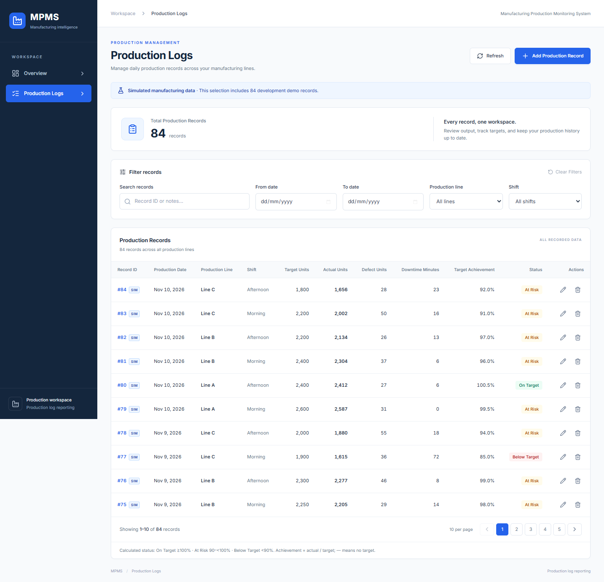
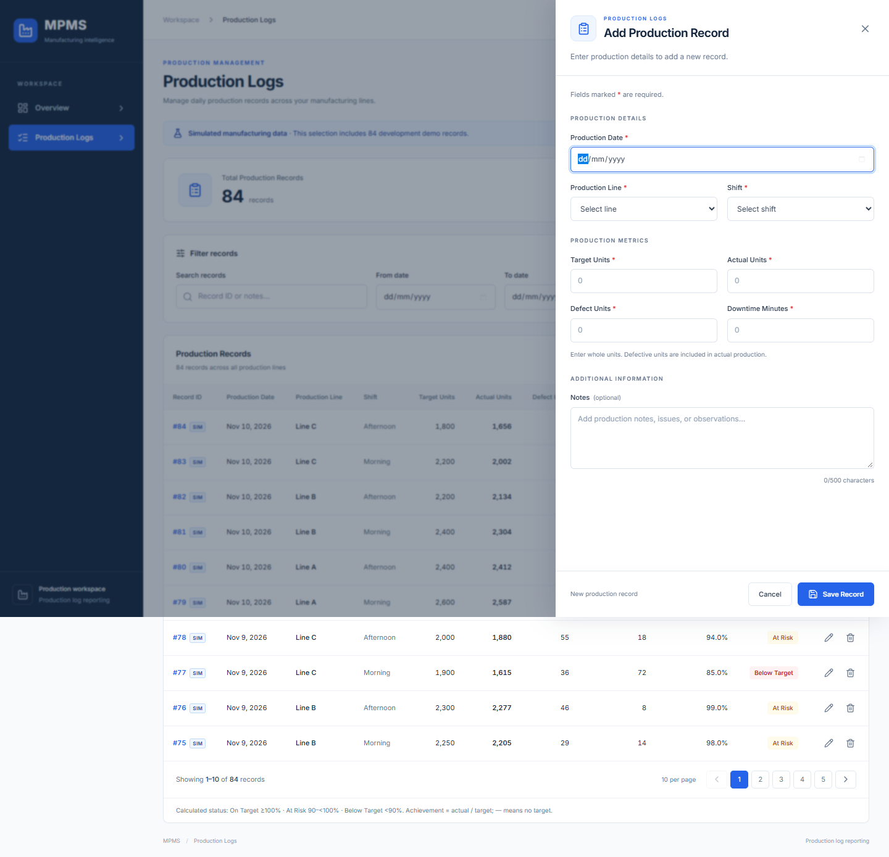
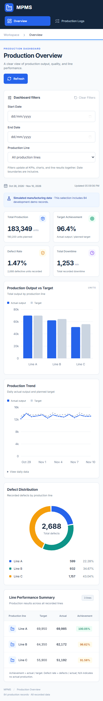
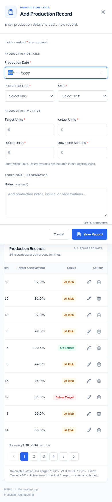

# Manufacturing Production Monitoring System (MPMS)

A full-stack manufacturing reporting application built with **C#, ASP.NET Core 10, Entity Framework Core, SQLite, React, and TypeScript**. MPMS connects production-log management with an API-driven dashboard for output, targets, defects, downtime, and line performance.

**Independent portfolio project. MPMS is not an official Astra Otoparts system and is not affiliated with or endorsed by Astra Otoparts.** The included generator and intended online demo use **synthetic, simulated manufacturing data**. No factory systems, company databases, or live telemetry are connected.

**Source:** [tottifawwazr/manufacturing-monitor](https://github.com/tottifawwazr/manufacturing-monitor)

**Online demo:** Not deployed. The prepared public demo configuration is read-only; full CRUD remains available locally. No MPMS backend deployment is included in this publication.

## Manufacturing problem

Shift-by-shift production records are difficult to compare when output, targets, defects, and downtime are stored separately. MPMS puts those records in one database and applies a consistent date range and production-line selection to the dashboard, helping a reviewer compare daily and line-level results without manually recalculating totals.

## Features

- Four database-derived KPIs: total production, target achievement, defect rate, and total downtime.
- Grouped output/target chart, daily trend, defect distribution by line, and line performance table.
- Shared dashboard date/line filters, Refresh, and loading/error/empty states.
- Production Logs CRUD with validated Add/Edit drawer, delete confirmation, ID/notes search, date/line/shift filters, and 10-row pagination.
- Deterministic 14-day development generator: Line A — Robotic Stamping; Line B — Laser Welding; Line C — Surface Treatment; Morning and Afternoon shifts.
- Explicit simulated-data labels, responsive desktop/mobile layouts, keyboard-friendly dialogs, and horizontal scrolling for wide tables.
- Production configuration guards, exact-origin CORS, safe liveness/readiness probes, and a read-only public-demo mode.
- Isolated xUnit and Playwright test databases; GitHub Actions verification without deployment credentials.

## Technology stack

| Layer | Technology |
| --- | --- |
| API | C#, ASP.NET Core 10, REST/JSON, Data Annotations |
| Data | Entity Framework Core 10, SQLite, EF migrations |
| Frontend | React 19, TypeScript 6, Vite 8, plain CSS |
| Visualization | Recharts, lucide-react |
| Testing | xUnit, WebApplicationFactory, SQLite in-memory, Node test runner, Playwright |
| Deployment preparation | Multi-stage Dockerfile, persistent volume, Render Blueprint, GitHub Actions |

## Architecture



Locally, Vite proxies `/api` to port 5084. The recommended hosted layout packages React's static build into ASP.NET's `wwwroot`, so one HTTPS origin serves the UI and API. Production SQLite is a **new database on a mounted persistent disk**, never a copy of the local development file. See [deployment requirements and runbook](docs/DEPLOYMENT.md).

## Repository structure

```text
ManufacturingMonitor.Api/          API, model, EF migrations, explicit seed commands
ManufacturingMonitor.Api.Tests/    xUnit integration tests and separate browser-test host
mpms-web/                         React application, logic/API tests, Playwright tests
docs/                             Deployment, portfolio, publication notes, real screenshots
.github/workflows/ci.yml           Builds, tests, audits, container smoke check; no deployment
Dockerfile, compose.yaml           Single-service image and local persistent-volume example
render.yaml                       Paid Docker service + persistent disk; manual deploys
```

## Local installation

Requirements: **.NET 10 SDK**, **Node.js 24** and npm. Python 3 is optional for the read-only database verifier. Docker is only required for the container procedure.

```sh
git clone https://github.com/tottifawwazr/manufacturing-monitor.git
cd manufacturing-monitor
dotnet tool restore
dotnet restore MPMS.sln
cd ManufacturingMonitor.Api
dotnet ef database update -- --environment Development
```

Optionally populate an initialized development database, then run the API:

```sh
dotnet run --launch-profile http -- --seed-demo
dotnet run --launch-profile http
```

In another terminal:

```sh
cd mpms-web
npm ci
npm run dev
```

Open the URL printed by Vite. The API listens at `http://localhost:5084`. In PowerShell, use `npm.cmd` if execution policy blocks `npm.ps1`. Restart the API after backend source changes.

The development generator plans 84 records across **October 28–November 10, 2026**. It skips occupied date/line/shift slots and never overwrites or deletes existing records. This working development database contains 84 records, including 83 generated records and one preserved original. A fresh empty database receives 84 generated records. Databases are excluded from Git and Docker build contexts.

## Configuration

| Setting | Purpose |
| --- | --- |
| `VITE_API_BASE_URL` | Public build-time API prefix; default `/api`, or `https://YOUR-API.example/api` for separate hosting |
| `VITE_DEMO_READ_ONLY` | Public build-time UI setting; `true` disables mutation actions for the public demo |
| `ASPNETCORE_ENVIRONMENT` | `Development` locally; `Production` when hosted |
| `ConnectionStrings__DefaultConnection` | Production SQLite connection string with an absolute file path on persistent storage |
| `AllowedHosts` | Exact production hostname(s), separated by semicolons; no `*` in Production |
| `Cors__AllowedOrigins__0` | Optional exact HTTPS frontend origin for separate-origin hosting; no wildcard/credentials |
| `Demo__ReadOnly` | Server-side mutation protection; defaults to `true` in Production and `false` in Development |

Frontend `.env.example` can be copied to `.env.local`. **Vite values are public and embedded during build; never put secrets in `VITE_*`.** ASP.NET does not automatically load `.env` files: set backend values through the shell, host environment UI, Docker `env_file`, or development user-secrets. Development settings stay in `appsettings.Development.json`; Production has no fallback development connection string. Rebuild the frontend after changing its public settings. [Vite's environment documentation](https://vite.dev/guide/env-and-mode.html).

## REST API

| Method | Endpoint | Behavior |
| --- | --- | --- |
| GET | `/api/productionlogs` | All stored records, sorted newest date then newest ID |
| GET | `/api/productionlogs/{id}` | A record, or 404 |
| POST | `/api/productionlogs` | Create validated record; 201 and Location |
| PUT | `/api/productionlogs/{id}` | Update record; 204, or 400/404 |
| DELETE | `/api/productionlogs/{id}` | Delete record; 204, or 404 |
| GET | `/api/dashboard/summary` | Aggregated KPIs, record count, and simulated-record count |
| GET | `/api/dashboard/trend` | Daily target, actual output, and defects |
| GET | `/api/dashboard/lines` | Per-line targets, output, defects, downtime, achievement, and defect rate |
| GET | `/healthz/live` | Process liveness; status only |
| GET | `/healthz/ready` | Database/schema readiness; status only, 503 if unavailable |

All three dashboard endpoints accept optional `startDate=yyyy-MM-dd`, `endDate=yyyy-MM-dd`, and `productionLine=Line%20A`. Date boundaries are inclusive. Invalid or reversed ranges return 400. Logs filtering/pagination is client-side for this MVP. OpenAPI is available only in Development at `/openapi/v1.json`.

Example create/update body for local CRUD:

```json
{
  "productionDate": "2026-11-10",
  "productionLine": "Line B",
  "shift": "Morning",
  "targetUnits": 2400,
  "actualUnits": 2320,
  "defectUnits": 28,
  "downtimeMinutes": 12,
  "notes": "Simulated example: fixture changeover reduced output."
}
```

Targets must be positive integers; actual, defect, and downtime values must be nonnegative integers within the backend's 32-bit field range. Defects cannot exceed actual production. Date, line, and shift are required; Notes is optional with a 500-character maximum. Production read-only mode returns 403 for API mutations. CORS is not authentication and does not replace this server-side guard.

### Business calculations

- Target achievement = `sum(actual units) / sum(target units) × 100`.
- Defect rate = `sum(defect units) / sum(actual units) × 100`; zero actual output returns `null`, displayed as **N/A**.
- Total downtime = `sum(downtime minutes)`.
- Logs status is calculated in the frontend: **On Target ≥100%**, **At Risk ≥90% and <100%**, **Below Target <90%**. Thresholds use the unrounded achievement.

These are ratios of database totals, not averages of record percentages. OEE, machine availability, and real-time factory telemetry are not implemented.

## Testing and actual results

From the repository root:

```sh
dotnet build MPMS.sln --artifacts-path .artifacts/verify
dotnet test MPMS.sln --no-build --no-restore --artifacts-path .artifacts/verify
```

From `mpms-web`:

```sh
npm ci
npm run build
npm run lint
npm test
npx playwright install chromium
npm run test:e2e
```

| Check | Latest local result |
| --- | --- |
| Backend build | Passed, no compiler warnings |
| xUnit integration tests | **55 passed** |
| Frontend build / lint / logic+API tests | Passed / passed / **19 passed** |
| Playwright desktop/mobile cases | **14 passed** |
| Published Production-mode app | UI routing, real API data, health probes, read-only controls verified locally |
| Existing development data | All **84 records unchanged**, including **83 simulated markers** |

xUnit uses isolated in-memory SQLite databases. Playwright starts a separate QA API on 5187 and Vite on 5186, never the development API/database. Existing test behavior is retained and production configuration tests added. See [QA.md](QA.md) and [Phase 5 verification](docs/PHASE5-VERIFICATION.md). GitHub's container job is prepared but **Docker was unavailable locally**, so image execution and the hosted demo are not claimed as verified.

## Screenshots

Actual screenshots from an isolated QA database with **84 simulated records**; no local development database or company data was published.

| Production dashboard | Production Logs |
| --- | --- |
|  |  |



<details>
<summary>Mobile dashboard and record drawer</summary>




</details>

Regenerate screenshots using the documented isolated Playwright capture command in [the portfolio guide](docs/PORTFOLIO.md).

## Deployment, GitHub and portfolio

- [Deployment runbook](docs/DEPLOYMENT.md): hosting research, storage, environment values, backups, and exact steps requiring owner action.
- [Publication checklist](docs/GITHUB-PUBLICATION.md): repository identity, clean-source review and publication checks.
- [Portfolio and CV text](docs/PORTFOLIO.md): factual descriptions, ATS-friendly bullets, screenshots and interview explanation.
- GitHub Actions verifies code and a Docker smoke test; it contains no service credentials and deploys nothing. The Render Blueprint disables automatic deployments.

## Limitations

The intended public demo is read-only because this MVP has no authentication or authorization. Local CRUD remains available. SQLite is appropriate for a small, single-instance demo; horizontal scaling and multi-user conflict handling require a different persistence/concurrency design. Disk backups and restore procedures remain the owner's responsibility. Browser automation currently covers Chromium desktop/mobile emulation, not Firefox, WebKit or physical devices. Inter loads from Google Fonts with system fallbacks. Docker and a real external deployment still require validation by the owner. The known development-only lint dependency advisory is recorded in the QA documents; production npm and NuGet audits are reported separately.

No project license has been selected. Add an appropriate `LICENSE` before granting reuse rights; third-party dependencies retain their own licenses.
